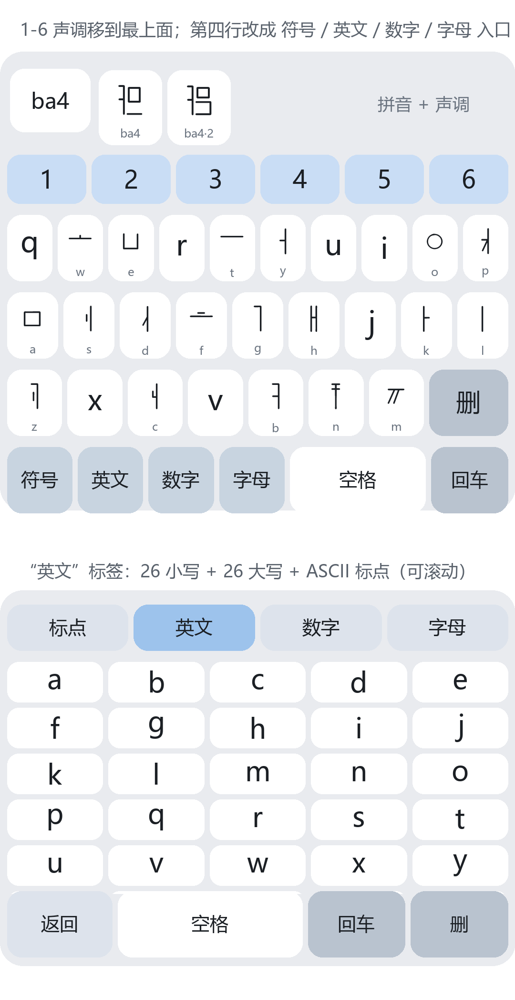

# 化州文输入法（安卓版）

用拉丁拼音输入**化州文**的安卓输入法。化州文是项目作者自建的文字，字符放在 Unicode 补充私用区 A（U+F4930 起），字形全部由自带字体提供。

- 包名：`com.huazhou.ime`
- 版本：v5.1（versionCode 7）
- 系统要求：安卓 5.0 及以上（最低 API 21），目标 API 34
- 安装包：[`app/huazhou-ime-v5.1.apk`](app/huazhou-ime-v5.1.apk)
- 只用 Java 和安卓原生框架，不依赖 Gradle、AndroidX，直接调用构建工具链编译



## 功能

- **拼音输入**：敲 `ba`，候选栏列出这个音节的 ba1–ba6 全部字形；再点 `1`–`6` 选声调，只显示该调的字形
- **化州文键帽**：键帽用内置字体显示化州文字母，下面一行小字是拉丁字母对照
- **标点页**：中文标点 84 个、英文标点 87 个（26 小写 + 26 大写 + 符号）、数字 30 个、字母表（20 声母 + 41 韵母）
- **回车即换行**：有没上屏的拼音会先上屏再换行，不触发搜索或发送
- **防闪退**：上屏相关的回调都做了异常保护，个别输入框抛错也不会带崩输入法
- **自适应图标**：安卓 8.0 以上使用分层图标，圆形遮罩不会裁到字形

## 安装

1. 下载 `app/huazhou-ime-v5.1.apk`，传到手机安装（系统会提示允许「安装未知来源应用」）
2. 打开「化州文输入法」，点 **1 启用输入法**，在系统设置里勾选它
3. 回到应用点 **2 切换到本输入法**，或在任意输入框长按后选择本输入法

> 安装包使用调试证书签名，仅供自用和测试；正式发布请换成自己的签名证书。

## 数据

数据来自项目作者的化州文对照表，构建时整理成两个资源文件：

| 文件 | 内容 | 规模 |
| --- | --- | --- |
| `assets/dict.tsv` | 每行「音节、字形」 | 9284 个带调音节，18600 个字形 |
| `assets/letter_index.tsv` | 每行「类型、罗马字母、字形」 | 20 个声母 + 41 个韵母 |

字符都在补充私用区 A（U+F4930–U+F9214），代码里按码位切分（`Character.charCount`），不能用 `charAt`，否则代理对会被切坏。

## 构建

需要 JDK 17、安卓构建工具 34、API 35 的 `android.jar`，放在本仓库上一级的 `tools` 目录下（路径写在 `build.ps1` 开头，可自行修改）：

```powershell
cd huazhou-ime-repo
powershell -ExecutionPolicy Bypass -File build.ps1
```

编译流程：编译资源 → 链接资源 → 编译 Java 源码 → 转成 dex → 打包 → 对齐 → 签名，分别对应 `aapt2 compile`、`aapt2 link`、`javac`、`d8`、`zipalign`、`apksigner` 六步。

单元测试（不需要模拟器）：

```powershell
javac -encoding UTF-8 -d build/testclasses src/com/huazhou/ime/Dict.java src/com/huazhou/ime/Punct.java test/DictTest.java test/PunctTest.java
java -cp build/testclasses DictTest assets
java -cp build/testclasses PunctTest
```

## 目录

```
├─ AndroidManifest.xml
├─ build.ps1              # 不用 Gradle 的构建脚本
├─ src/com/huazhou/ime/   # 输入法服务、键盘视图、字典、标点表、引导页
├─ res/                   # 图标、文字资源、输入法声明
├─ assets/                # 字典 + 字体
├─ test/                  # 纯 Java 单元测试
├─ tools/                 # 资源生成、图标生成、打包脚本
├─ docs/                  # 截图
└─ app/                   # 编译好的安装包
```

## 字体说明

化州文字形只存在于 `assets/hzfont.ttf` 里。输入法界面和候选栏用这个字体渲染，能正常显示；但**上屏到别的应用时用的是对方的系统字体**，没装这个字体就会显示成方框。应用内有「导出字体」按钮可以把字体导出来，部分品牌机支持装进系统字体。

字体文件版权归作者所有，随仓库提供仅用于本项目的构建与运行。

## 已知限制

- 未在真机上长期验证（开发环境没有安卓设备），逻辑层有单元测试覆盖
- 候选只有字形，没有词库联想，一次输入一个音节
- `q r u i v j x` 在化州文字母表里没有独立字形，这 7 个键帽显示拉丁字母
- 同一音节的不同字形没有语义标注，候选用 `ba4`、`ba4·2` 区分

## 开源协议

代码采用 MIT 协议：中文版见 [LICENSE](LICENSE)，英文原文见 [LICENSE.en.txt](LICENSE.en.txt)。字体文件不在 MIT 授权范围内。
